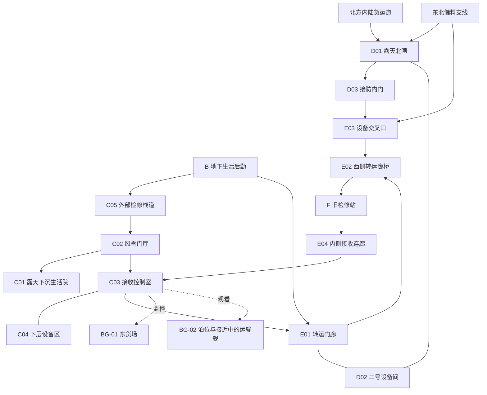

> 来源附件 · 功能锚点与拓扑；旧全图尺寸已停用。正文保留作追溯，当前口径以本包01—10分册为准。链接已调整为包内引用或旧工程相对条目；不执行附件中的命令。
> 原项目相对位置：game-adaptations/重返木卫六/design/MAP_DESIGN_GANYMEDE.md

# 《重返木卫三》地图设计 v2
策划日期：2026-10-25。与 [科幻设定稿 v1](world_ganymede.md) 配套。2026-10-26 已建立全地图环境首版；本页保留策划尺寸，模型实测与通行核对见 全地图交付（旧工程条目：game-adaptations/重返木卫六/build/FULL_MAP_DELIVERY.md）。游戏试玩尚未进行。

本版接续 迁址前地图 v1（旧工程条目：game-adaptations/重返木卫六/design/MAP_DESIGN.md） 的六组空间、21 个子空间和十二段主线，将真空岩地港改为有大气的寒冷工业港。现有 C05、D01 的网格、门体、设备和高差关系是可复用基础；具体改建留到文字方案确定之后。

## 1. 体验与范围

玩家以陆闻川、周延两个视点，在同一座港口完成营救、护送、接防与撤回。战斗方法和短距离路线可变，人物的关键决定固定。核心循环为：观察压力与人的去向 → 清出一段通路 → 完成一次具体交互 → 看见人员或设备真正通过 → 接续下一项任务。

一小时的主线让玩家记住三个变化：
1. 从地下生活区走到能呼吸、有风、有生活痕迹的露天港区，看见木星与同一组地标。
2. 亲手保住的路线持续有人使用；居民、检修人员、接防队和伤员各有去向。
3. 周延的职责由同伴接过，接收工作最终启动，他本人却没有回到岗位。

仍采用单人线性 FPS、第一人称双主角、统一引擎内演出。无开放世界、飞行驾驶、磁网维修长任务、环境生存条或分支结局。新的天气与生活细节服务现有动作，不另外增加观光或跑腿关卡。

## 2. 地理骨架与天空

### 2.1 冰脊港的三层地理

- **自然层：** 古老暗色冰质台地、斜向沟槽、裸露浅色冰脊与受污染的积雪。坑缘和坡脚有冰岩碎块；不把地面全部做成连续裸岩或纯白雪毯。
- **工程层：** 填筑作业坪、隔热基础、跨沟廊桥、管架与排水回收槽。建筑贴着原有高差生长，后期修补层可辨。
- **生活层：** 挡风小院、温室边角、通勤停靠位、热水管、检修告示和反复清理出的步行道。军用障碍压在这些既有用途之上。

可玩组织范围沿用约 360×280 米；其中绝大部分是建筑、地形与受管理作业区，不是整片自由战场。近中景先按约 800×600 米保持地理连续，远景以数公里外的冰脊、温室屋面、能源设施和泊位群建立卫星尺度。远方可见设施不承诺能够抵达。

A 是十年前的独立序章。现在时港区由 B—F 组成；B 的旧地下空间仍在使用，与新增露天生活并存。温暖与宜居不等于每一户都搬到了地表。

### 2.2 固定方向

港图北上、东右。北方与东北是敌方控制的内陆货运和储料方向；东偏南是泊位开阔面；西南为生活后勤和旧检修站。

天空工作点采用相对下木点向西约 74°、北纬约 10°的虚构选址。木星方位约 93°、仰角约 16°、直径约 7.7°；太阳暂在西方、仰角约 8°。这是简化几何条件，尚未选定真实日期星历。

C05 的外景转折、D01 的东侧开口、C03 窗面和 E02 的露天段都朝同一片东南天空。北闸敌人主要来自北方，木星位于侧后背景，不要求玩家为了看天体一直背对威胁。战斗场景没有强制抬头镜头。

### 2.3 重复地标

| 地标 | 固定位置与形态 | 玩家如何再次认出 |
| --- | --- | --- |
| 木星 | 东偏南、仰角约 16°；允许云层局部遮挡 | 天体大小、方向和光照相位一致 |
| 双臂货运吊架 | 东南泊位，其中一条臂架有旧修补段 | C05 初见；D01 侧看；C03 接收灯从其下方延伸 |
| 三列换热塔 | 北闸与控制区之间，错列而不挡主要射界 | 风机和管网体现用途；干式散热部分不无故冒烟 |
| 西侧廊桥 | 跨排水与维护沟，连接转运枢纽和旧检修站 | S04 远看，S08 护送通过，S10 接上，S12 从安全连廊回望 |

磁网维护设施只进入远景或公共信息，不将其中一座塔设为本篇可摧毁的“全星盾牌开关”。

## 3. 交通、垂直关系与室内外规则

实线为实际通路，不代表所有阶段都开放；虚线为观看关系。东北支线到 E03 的连接要提前通过门牌、车道和报告建立，它绕过已关闭的北闸，不从救护点背后突然生出敌人。

以 C03 主层为 Z=0：B 约 -18 m，C01 约 -6 m，C04 与 F 约 -3 m，D01 下层约 +4 m、上层约 +8 m。C05 沿台地绕行；E 系统用坡道连接，担架与车辆通路没有只靠梯子的断点。尺寸和净空均是后续白盒起点。

常规室外与室内气压接近。C02、D02、D03 的双门主要保温、防风及阻烟，原门袋与滑动机构可以保留；正常通行不强制长时间气闸循环。避难厅和医院具备关闭隔断的能力，闭门缘由由枪火、消防、温度或隔离说明。

## 4. 21 个子空间与地图职责

| 编号 | 本版名称／尺度起点 | 空间任务与新增环境依据 |
| --- | --- | --- |
| A01 | 避难主厅，约 38×28 m | 早期地下公共设施；旧气密结构、食物包装和保暖衣物说明居民生活 |
| A02 | 西侧检修门与梯道 | 父亲送走孩子；门内回望位置与实际撤离通路分开 |
| A03 | 主厅防守侧 | 年轻周延掩护另一批人，坍塌后从不同开口见证班长遇害 |
| B01 | 地下维修廊 | 风机和热交换设施有去向；修复动作恢复此处工作声 |
| B02 | 护理后勤 | 许岚组织物资；可见保温毯、转运名单与公共服务缺口 |
| B03 | 旧样本室／集合 | 冰芯与旧勘察样本；港图说明技工、北闸、接收的相对位置 |
| C01 | 露天下沉生活院，24×20 m、Z≈-6 m | 宿舍门、短连廊、风挡与民用设施；押运军车侵占居民转运位置 |
| C02 | 风雪门厅，主干约 25 m | C05、C01 与内部港务通路汇合；门后容纳一组人，供家属交接 |
| C03 | 接收控制室，24×18 m | 东南看泊位；内侧监控展示邵原，不能与窗外可射击目标混淆 |
| C04 | 下层设备区，34×24 m、Z=-3 m | 桥、升降台、泵组和控制柜；必经检查位看见设备逐项恢复 |
| C05 | 外部检修栈道，约 90×28 m | 沿冰脊与建筑基础绕行，观察下方生活院；两条接近线在 C02 前汇合 |
| D01 | 露天北闸，72×55 m、Z=+4/+8 m | 下层车道、上层检修台、两个敌方来向与一条受保护的横向工人通路 |
| D02 | 二号设备间，16×12 m | 供热与门机的地方设备间；争执发生在枪火和风声被隔开的工作位 |
| D03 | 接防内门／休息位，8×6 m | 换班后的安全落点；周延坐下接受护具帮助并回复家人 |
| E01 | 转运门廊，18×12 m | 半开放挡风厅；门机卡住，修好后病人和车辆真正通过 |
| E02 | 西侧转运廊桥，折线约 115 m | 封闭段、遮棚段、露天段交替；单车狭口与步行旁路承担不同用途 |
| E03 | 设备交叉口，32×26 m | 室外管架与局部遮棚构成救援接力；北接 D03，西南接 E02，东接敌方支线 |
| E04 | 内侧接收连廊，约 110 m | 安全回程，部分有顶、部分露天；可见此前送达的人和正在接续的工作 |
| F01 | 旧检修站登记口 | 担架直入救治，家属先登记；原检修龙门架不挤占流线 |
| F02 | 救治隔间 | 温暖、独立工作面、隔帘；周延与孟齐分别得到救治 |
| F03 | 安置与等候 | 同一批家属持续出现；死亡之后仍有实际护理与接收工作 |

B 的三个子空间合为约 45×22 m，F 的三个子空间合为约 40×30 m。BG-01 仍只为监控服务；BG-02 覆盖泊位、城镇和天体远景，不另设可探索关卡。

## 5. 重点空间细化

### C05：沿冰脊工作的检修栈道

**开场构图。** 从升井后的风雪门厅出来，先看到脚下连续的金属地坪、覆霜支架和半埋基础。向前绕过建筑转角后，东南侧露出低处生活院、跨沟廊桥、泊位与木星。近景有人使用的设备，中景是完整港口，远景是冰脊与天空；不能只剩悬在黑背景中的一条金属桥。

**两条局部路径。**
- 上侧检修线较短，先看见院内押运；一次较清楚的暴露段使玩家需要处理上方守卫或等待队友掩护。
- 下侧管线线遮挡较多，较晚看清院落，经过转角再接近门厅；不是额外秘密关，也不绕过营救目标。

**战斗边界。** 室外已有大气，玩家可以利用视线向实际暴露的敌人射击。栏杆和普通风挡不能伪装成万能挡弹墙；工人及家属在硬质遮护后。若玩家提前消灭可见守卫，进入院落后保持这一结果，不把敌人重新刷回原位。最后仍需抵达后门、打开通路并交接居民。

**生活细节。** 管线编号、冰层取样孔、旧工牌夹、临时补丁和下方清出的步道说明闻川熟悉这里。小片温室位于院边安全区，缺一块外遮板但内部仍有灯；它是居民工作的延续，不新增种植任务。

**声音和天气。** 能听到风、栈道振动、远处车声与枪声。吹雪从冰脊侧斜过，不能持续盖住关键敌人；蒸汽只出现在确有湿热排放的局部设施。

### C01—C02：露天生活院与风雪门厅

取消原方案的整院压力顶盖，保留局部遮棚、楼梯、连廊与可以躲避射击的实体结构。院内有公交停靠线、搬运凳、修理车和住户留下的小物件，军用车压住通勤位置。人员穿保暖服，近处可以辨认脸和互相寻找的动作。

C02 是家属交接点。两扇原气闸门现在主要挡风保温；开门时手部动作短，门袋、净宽和等待位继续成立。没有“不开气闸所有人立刻窒息”的风险，也不在风雪里安排长对话。

### D01：露天北闸的三次使用

北闸控制的是公路、人员与货运许可，设检查亭、称重位、车辆挡块、维护坡道和装卸设备。它不是大气穹顶的边缘，关闭北闸不会关掉天空。

| 使用 | 站位与压力 | 玩家看到的关系变化 |
| --- | --- | --- |
| S05 | 下层装卸位；北车道先施压，东北支线后加入 | 周延守住别人通行的条件，却独自掌握情报 |
| S07 | 上层检修台斜向掩护，沿侧阶缩回 | 孟齐提供可执行的转运方案；周延采用并共享完整消息 |
| S09 | 侧阵位交接后，穿过 12—16 m 的两段横向通路 | 孟齐站到原位置，郑铎接应，周延实际走在别人提供的掩护中 |

常用交火距离约 18—60 m；远侧 70—90 m 的威胁要有可辨轮廓。实体掩体之间通常留 6—12 m 的可判断移动段。重型服务车、设备基础与复合隔墙提供遮护，薄板、栏杆和观察玻璃以边界表达为主。

北侧来风使积雪堆在墙脚和障碍背面，主车道留有压实车辙。暖管附近局部湿暗，冰面由排水沟收束；不把每条可走路线都做成滑倒机制。东南侧的木星和吊架提供方向，不能用巨大天体盖住北方射界。

设备人员完成撤回后，接防队关闭内侧军事隔断，再经 D03 分段撤离。东北维护支线仍被敌方控制，通向 E03；先前的北闸防守成果仍然成立。

### E02：可以看见天空的转运廊桥

115 m 路线按约 30 m 封闭段、45 m 有顶敞侧段、40 m 露天段组织，具体分段可随净空调整。封闭段提供对白与热缓冲；遮棚段让车队、玩家和远处地标同时可见；露天段让转运确实穿过天气。

狭口约 2.6 m 净宽、8—10 m 长，通行车宽约 1.5 m；另有约 1.3—1.5 m 的步行绕行线。瓶颈来自桥头旧承重结构和维护设备，具有可见理由。选择路线不能要求伤员越过栏杆、爬直梯或穿过不可推车的碎冰坡。

前段的阻滞是侧维护口火力，后段是车轮故障与通道转换。玩家只参与一次短搬运，NPC 持续推车。挡风板、桥墩与封闭段分隔火线；清出的安全段保持清楚，不为了每次回访再刷一批敌人。

### E03：共同救援的室外接力

孟齐在中央设备基础附近负伤，周延从北侧 D03 出来，郑铎从西南接近，敌人来自已建立的东侧储料支线。西南后方直接接上已经保住的 E02，救护点在更后方。

1. 玩家保持作战控制，处理近处威胁，形成到设备基础后的接近条件。
2. 队友站定后，玩家确认“协助转移孟齐”，双手占用；先把孟齐送到西南实体遮护里。
3. 接力继续时进入统一演出。此前预告的敌方尾组从东侧接近，周延受击并主动报伤，队友转运两名伤员。
4. 沿已保住的 E02 到 F，孟齐获救、换班成立与路线可用均保持有效。

天气不负责杀死周延。不能加入爆破磁网、摘掉氧气给别人、撑住失压门或回到无人阵位等会撤销其成长的桥段。受击不由玩家最后一发子弹、按键速度或协作熟练度决定。

### F—E04—C03：温暖、失去与继续工作

F 的温暖来自可辨认的供热与隔离设施；濡湿外套、保温毯和门边积雪强化室内外差别，医疗工作面保持清洁。群众不堵住担架入口。

E04 提前作为工作人员通路出现在港图上。终章沿它返回，玩家看到有人收回担架、交接设备、清出接收口。木星位置没有改变，泊位灯和人员分工变了。结尾不新加一场战斗或全面光复庆典。

## 6. 十二段流程与演出

战斗、非战斗操作、专门演出预算继续为 30.5／16.5／13 分钟。并行对白只计入当前操作，不重复加时。以下均为策划值，首通目标仍是 55—70 分钟。

| 段落／时长 | 视点与路径 | 玩家可操作内容 | 统一实时演出／关系变化 |
| --- | --- | --- | --- |
| S01／3 分钟 | 儿童闻川；A01→A02 | 跟随、观察、穿过隔断 | 父亲交出孩子后拾枪牺牲；孩子已在撤离通路内 |
| S02／4 分钟 | 年轻周延；A03↔A02 | 有限防守、开门、掩护一批人通过 | 目标完成后坍塌受困，见证其余平民遇害与班长被处决 |
| S03／4 分钟 | 闻川；B01→B02→B03 | 修风机、交物资、领装备 | 确认共享情报和护送后换班；生活能力先于战斗表现 |
| S04／7 分钟 | 闻川；C05→C02→C01 | 观察押运、选择接近线、营救、开通居民出口 | 罗敬提出家属需求，孟齐落实交接；追踪带来共同收益 |
| S05／6 分钟 | 周延；D02→D01 | 下层防守，保障工人横向撤回 | 接到邵原预告并主动隐瞒；玩家知道，闻川尚不知道 |
| S06／4 分钟 | 闻川；E01→D02 | 修门、让病人通过，由正常联络补全信息 | 安静工作位争执，双方仍继续履职 |
| S07／6 分钟 | 周延；D01 上层→D03 前 | 掩护收尾、采用单车通行方案、发送完整报告 | 承认隐瞒并报出换班需要，先改变做法 |
| S08／7 分钟 | 闻川；C03→C04→E01→E02→F | 核对成果、清路、短搬运、完成护送 | 先修复关系，再放弃现实追击机会；孟齐因此能去接防 |
| S09／6 分钟 | 周延；D01→D03 | 最后防守、交出位置，在同伴掩护下亲自撤出 | 接受护具帮助与休息，回复家人；成长已经完成 |
| S10／7 分钟 | 周延；D03→E03→E02→F | 有限战斗、共同救援孟齐 | 救援先成功，后续接力中周延受击、主动求援，两人都被送回 |
| S11／4 分钟 | 闻川；F01→F02／F03 | 交接装备和资料、探视 | 周延接受救治后死亡，孟齐存活；闻川得到同伴帮助 |
| S12／2 分钟 | 闻川；F→E04→C03 | 报告、传递需求、扶门让接收人员通过 | 泊位与舰队确认进场，只开启后续光复机会 |

固定剧情的取舍不包装成对话选择。S08 的监控不生成可走的“追击邵原”岔路；S10 的固定伤情不使用失败界面，跳过演出保持同样的转运结果。

### 环境时间预算

| 段落 | 露天／分钟 | 有顶敞侧／分钟 | 封闭室内／分钟 |
| --- | ---: | ---: | ---: |
| S01 | 0 | 0 | 3 |
| S02 | 0 | 0 | 4 |
| S03 | 0 | 0 | 4 |
| S04 | 4.5 | 1.5 | 1 |
| S05 | 4.5 | 0.5 | 1 |
| S06 | 0 | 2 | 2 |
| S07 | 4.5 | 0.5 | 1 |
| S08 | 3.5 | 2 | 1.5 |
| S09 | 4 | 1 | 1 |
| S10 | 2.5 | 3.5 | 1 |
| S11 | 0 | 0 | 4 |
| S12 | 1 | 0.5 | 0.5 |
| 合计 | 24.5 | 11.5 | 24 |

这三类互斥，合计 60 分钟；与战斗／操作／演出是另一种分类。相较上一版，露天由约 14.5 分钟提高到约 24.5 分钟。空气、地貌与人物行动承担新增室外感，不延长总流程。主干行走约 1.1—1.3 km，尚未重新测量几何折线。

## 7. 战斗、引导与失败

敌人预算沿用原规划：全片约 76—102 人，普通难度同时活动约 6—8 人作为白盒起点，主要直接可见威胁约 2—4 人。天气不会成为无限增援的掩饰。每次有限增援从已建立的车道或支线到达。

局部因果如下：
- C05 先清掉的守卫保持死亡，下一空间读到相同结果；营救完成仍要求居民抵达安全交接位。
- E01 门修好后车辆通过，S08 与 S10 回读相应通路；不再要求重复修同一道门。
- S08 护送到站后，孟齐带接防队离开；S09 只有在接替成立后更新撤回目标。
- S10 战斗阶段可以阵亡重试；“协作就绪”后有检查点，固定伤情从清楚的动作交接进入演出。
- S11 没有寻找药品或复苏倒计时；既定死亡不能被解释为玩家停留太久。

单人必经净宽以不小于 1.3 m、双向主路约 2.4 m、转运门约 2.8 m 为起点，搬运转角随后用身体代理检验。挡风玻璃、薄板和栏杆不以错误视觉暗示可靠掩体。可用遮护、来敌方向与下一步目的地同时可辨。

普通枪声和车声可以经大气传播，远处声音应带距离、遮挡与方向；关键指令仍经无线电。风声、蒸汽和音乐不盖住队友告警。没有氧气 HUD、磁场技能条或随机环境伤害。

## 8. 资产与 Three.js 的后续边界

本节只记录保留与改建职责，不规定代码、材质实现或文件导出参数。

| 现有基础 | 本版用途 | 后续需要调整 |
| --- | --- | --- |
| C05 栈道、楼梯、栏杆与支架 | 继续支撑两条接近线与高度变化 | 补自然冰脊、建筑基础、院落联系与天空方向 |
| D01 作业坪、上层平台、车辆与门体 | 保留三次回访和交接路线 | 加入货运检查功能、挡风构筑、车辙与开阔远景 |
| 滑门、门袋、控制柜 | 改为风雪门厅及可关闭的消防隔断 | 调整标识与使用解释，保留分件和开闭净空 |
| 暗色碎石及地表网格 | 用作暗色冰质覆盖物、填筑与坡脚碎块 | 冰质露头、污染积雪和湿暗表面分区，减少纯岩山观感 |
| 跨沟货廊与支承 | 保留实际连通与转运瓶颈 | 分段开放侧面／顶部，补天气暴露与遮护关系 |
| 人物与武器代理 | 继续承担比例和站位 | 正式人物以保暖工装、护甲、可辨面孔为主，常规室外不强制压力头盔 |
| 远景吊架、阵列与仓体 | 建立港口尺度与重复地标 | 补冰脊、城镇轮廓、天空与云层；不复制每个近景细节 |

最终全部进入 Three.js，已有与下载网格可以继续适配。主线通路、碰撞遮护、移动门体、角色接触与远景表现应能分别处理，避免为了展示合成一件无法交互的场景。性能策略留到实际制作测量，本轮不以删除室外范围解决问题。

## 9. 关键体验验证计划

本轮只做文字因果走读。之后的模型与可玩验证应回答：

1. C05 的首次外景能否让玩家读出“冰脊、生活院、廊桥、泊位、木星”之间的关系，而不是五个互不相干的布景？
2. C05 的两条路是否有真实接近差别，院内居民是否可辨，提前击杀是否被后续空间保留？
3. 三次北闸作战是否改变站位、受保护对象和离场方式？若只是三轮原地清敌，应重排射界与行动。
4. 有风、有云、有积雪之后，18—60 m 的敌我轮廓和下一处掩体是否仍然清楚？
5. E02 的露天与遮棚分段是否提供节奏变化，是否容得下车辆、玩家和伤员接力？
6. 玩家能否先看见周延交接成功，再理解他参与协作救援、受伤和求援？若仍被当作操作失败，修改控制权与检查点衔接。
7. C05、D01、C03、E02 的木星方向和同一地标是否一致？以 16:9、70° 水平视场校核，垂直视场约 43°，木星中心约 15.6°、上缘约 19.4°，平视有机会看见完整盘面；地形仍需给出开口。7.7° 盘面在该水平视场中央约占画宽 9.6%，需用构图建立尺度，不能随场景放大。
8. 十二段能否在 55—70 分钟完成，终章是否仍给报告、停顿和开门留有时间？

下一次构建优先检验 C05 的外景与生活院联系、D01 的交接路径、E03 的协作转运。现有 r05 场景是迁址前资产基础，不能把本版新规则写成已经在模型中实现。

popup=no；delete=no。
